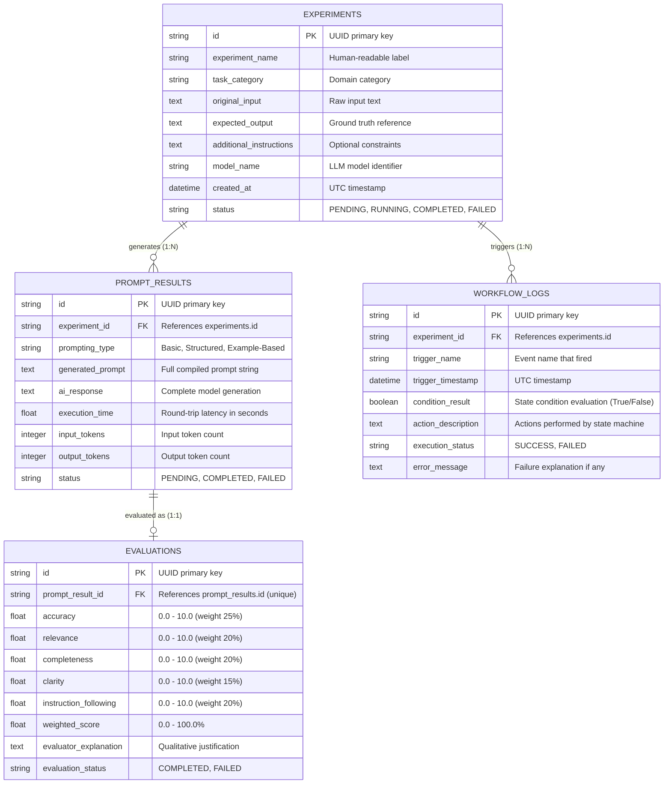

# Relational Database Schema & Data Dictionary

The **Prompt Performance Comparison System** uses SQLite with SQLAlchemy ORM. The relational model enforces referential integrity across experiments, prompting outputs, blinded evaluations, and verifiable workflow audit trails.

---

## 1. Entity-Relationship Diagram

---

## 2. Table Specifications & Constraints

### Table 1: `experiments`
| Column | Type | Constraints | Description |
|---|---|---|---|
| `id` | `VARCHAR(36)` | `PRIMARY KEY` | Unique UUID identifier |
| `experiment_name` | `VARCHAR(255)` | `NOT NULL` | Name or title of test |
| `task_category` | `VARCHAR(100)` | `NOT NULL` | Category (e.g. Text Summarization) |
| `original_input` | `TEXT` | `NOT NULL` | User input or test case text |
| `expected_output` | `TEXT` | `NOT NULL` | Target benchmark criteria |
| `additional_instructions` | `TEXT` | `NULLABLE` | Constraints or formatting flags |
| `model_name` | `VARCHAR(100)` | `NOT NULL` | Model (e.g. `gemini-2.5-flash`) |
| `created_at` | `DATETIME` | `NOT NULL` | UTC creation timestamp |
| `status` | `VARCHAR(50)` | `NOT NULL` | PENDING / RUNNING / COMPLETED / FAILED |

### Table 2: `prompt_results`
| Column | Type | Constraints | Description |
|---|---|---|---|
| `id` | `VARCHAR(36)` | `PRIMARY KEY` | Unique UUID identifier |
| `experiment_id` | `VARCHAR(36)` | `FOREIGN KEY (experiments.id) ON DELETE CASCADE` | Parent experiment link |
| `prompting_type` | `VARCHAR(50)` | `NOT NULL` | 'Basic', 'Structured', or 'Example-Based' |
| `generated_prompt` | `TEXT` | `NOT NULL` | Full compiled prompt text |
| `ai_response` | `TEXT` | `NULLABLE` | Raw LLM output |
| `execution_time` | `FLOAT` | `NOT NULL, DEFAULT 0.0` | Execution latency in seconds |
| `input_tokens` | `INTEGER` | `NULLABLE` | Prompt tokens reported by provider |
| `output_tokens` | `INTEGER` | `NULLABLE` | Completion tokens reported by provider |
| `status` | `VARCHAR(50)` | `NOT NULL` | PENDING / COMPLETED / FAILED |

### Table 3: `evaluations`
| Column | Type | Constraints | Description |
|---|---|---|---|
| `id` | `VARCHAR(36)` | `PRIMARY KEY` | Unique UUID identifier |
| `prompt_result_id` | `VARCHAR(36)` | `FOREIGN KEY (prompt_results.id) ON DELETE CASCADE, UNIQUE` | 1-to-1 relationship |
| `accuracy` | `FLOAT` | `NOT NULL` | Score 0.0 to 10.0 (25% weight) |
| `relevance` | `FLOAT` | `NOT NULL` | Score 0.0 to 10.0 (20% weight) |
| `completeness` | `FLOAT` | `NOT NULL` | Score 0.0 to 10.0 (20% weight) |
| `clarity` | `FLOAT` | `NOT NULL` | Score 0.0 to 10.0 (15% weight) |
| `instruction_following` | `FLOAT` | `NOT NULL` | Score 0.0 to 10.0 (20% weight) |
| `weighted_score` | `FLOAT` | `NOT NULL` | Aggregate score in % (0 - 100%) |
| `evaluator_explanation` | `TEXT` | `NULLABLE` | Qualitative rationale from blind evaluator |
| `evaluation_status` | `VARCHAR(50)` | `NOT NULL` | COMPLETED / FAILED |

### Table 4: `workflow_logs`
| Column | Type | Constraints | Description |
|---|---|---|---|
| `id` | `VARCHAR(36)` | `PRIMARY KEY` | Unique UUID identifier |
| `experiment_id` | `VARCHAR(36)` | `FOREIGN KEY (experiments.id) ON DELETE CASCADE` | Associated experiment |
| `trigger_name` | `VARCHAR(255)` | `NOT NULL` | Event identifier (`ON_ALL_PROMPTS_EVALUATION_COMPLETED`) |
| `trigger_timestamp` | `DATETIME` | `NOT NULL` | Exact UTC timestamp of trigger |
| `condition_result` | `BOOLEAN` | `NOT NULL` | Verification boolean result |
| `action_description` | `TEXT` | `NOT NULL` | Recorded action and export details |
| `execution_status` | `VARCHAR(50)` | `NOT NULL` | 'SUCCESS' or 'FAILED' |
| `error_message` | `TEXT` | `NULLABLE` | Logged exception details if any |

